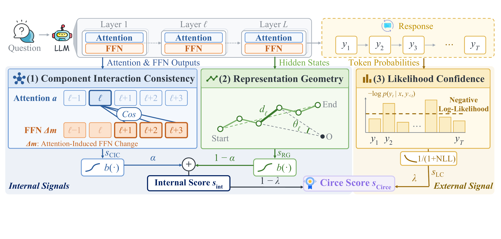

# CIRCE: Training-Free LLM Self-Evaluation via Component Interaction Consistency

This repository provides the Python implementation of [CIRCE](https://arxiv.org/abs/2611.07948), a training-free method for estimating the correctness of LLM responses. CIRCE combines Component Interaction Consistency (CIC), Representation Geometry (RG), and Likelihood Confidence (LC) into a unified score, using internal attention/FFN signals, hidden states, and token probabilities without reference answers or repeated sampling.



## Requirements

- Python >= 3.10
- PyTorch >= 2.5, < 2.7
- Transformers == 4.57.1
- NumPy >= 1.24, < 3
- A CUDA-capable GPU for inference

Install dependencies from the repository root:

```bash
pip install ".[inference]"
```

Supported model families include Llama, Mistral, Qwen2, and Qwen2.5. Use a local Hugging Face checkpoint and a CUDA-enabled PyTorch installation.

## Data

The main benchmarks cover four domains. Download the datasets from their original project pages:

| Domain | Datasets |
| --- | --- |
| Mathematics | [GSM8K](https://github.com/openai/grade-school-math), [MATH](https://github.com/hendrycks/math) |
| Reasoning | [CommonsenseQA](https://huggingface.co/datasets/tau/commonsense_qa), [TheoremQA](https://github.com/wenhuchen/TheoremQA) |
| Knowledge | [MMLU](https://github.com/hendrycks/test) |
| Understanding | [Belebele](https://github.com/facebookresearch/belebele) |

Prepare each dataset as a UTF-8 JSONL file under `data/`, with one question per line. Use `gsm8k`, `math`, `commonsenseqa`, `theoremqa`, `mmlu`, or `belebele` for `--dataset`.

Each record contains a unique `id`, the `question`, and a reference answer in `gold` for evaluation. A GSM8K example is:

```json
{"id":"example-1","question":"What is 2 + 3?","gold":"5"}
```

For multiple-choice questions, provide all `options` in their original order and use an uppercase option letter for `gold`:

```json
{"id":"example-2","question":"Which number is even?","options":["1","2","3","5"],"gold":"B"}
```

- Add `passage` for reading-comprehension questions. Question text should not duplicate separately supplied passages or options.
- For TheoremQA, also provide `answer_type`: `bool`, `integer`, `float`, `list of integer`, `list of float`, or `option`.
- GSM8K's original `answer` field and CommonsenseQA's `choices` / `answerKey` fields are also accepted. Reference answers are optional for inference, but required for automatic evaluation.

Datasets and model checkpoints are not included in this repository.

## Usage

Run the following commands from the repository root. Set the model and data paths, then copy `weights.example.json` to `weights.json` and replace `xxx` with numeric values for α and λ, each in `[0, 1]`.

1. Generate responses and compute CIRCE scores:

   ```bash
   python main.py \
     --model-path ./checkpoints/local-model \
     --data ./data/gsm8k.jsonl \
     --dataset gsm8k \
     --weights ./weights.json \
     --output ./runs/model_gsm8k \
     --device cuda
   ```

2. Evaluate the saved responses and scores:

   ```bash
   python evaluate.py \
     --runs ./runs/model_gsm8k \
     --output ./runs/evaluation
   ```

Evaluation reports accuracy, AUROC, correct-positive average precision (AP), and FPR95. Supply multiple run directories after `--runs` to evaluate several model/dataset runs together. Use a new output directory for each command.

Correct answers are positive; lower FPR95 is better. AP is average precision, and FPR95 uses the first observed threshold attaining at least 95% true-positive rate. Evaluation uses the final-answer policy by default; `--label-policy strict` requires the final `Answer: ...` line for GSM8K and multiple-choice questions. MATH and TheoremQA use their dataset-specific syntactic answer matching. Invalid or unfinished answers count as incorrect.

Paired bootstrap intervals use 5,000 resamples by default. Runs of the same dataset must contain matching question IDs and references for cross-model evaluation. Undefined metrics or intervals without sufficient class coverage are reported as unavailable. Run `python main.py --help` or `python evaluate.py --help` for other options.

## Citation

If you find this work useful, please cite:

```bibtex
@misc{miao2026circetrainingfreellmselfevaluation,
  title={Circe: Training-Free LLM Self-Evaluation via Component Interaction Consistency},
  author={Shuyi Miao and Zheng Li and Xu Xie and Linrui Xu and Fei Shen and Xiaoyu Du and Tat-Seng Chua},
  year={2026},
  eprint={2611.07948},
  archivePrefix={arXiv},
  primaryClass={cs.AI},
  url={https://arxiv.org/abs/2611.07948}
}
```
